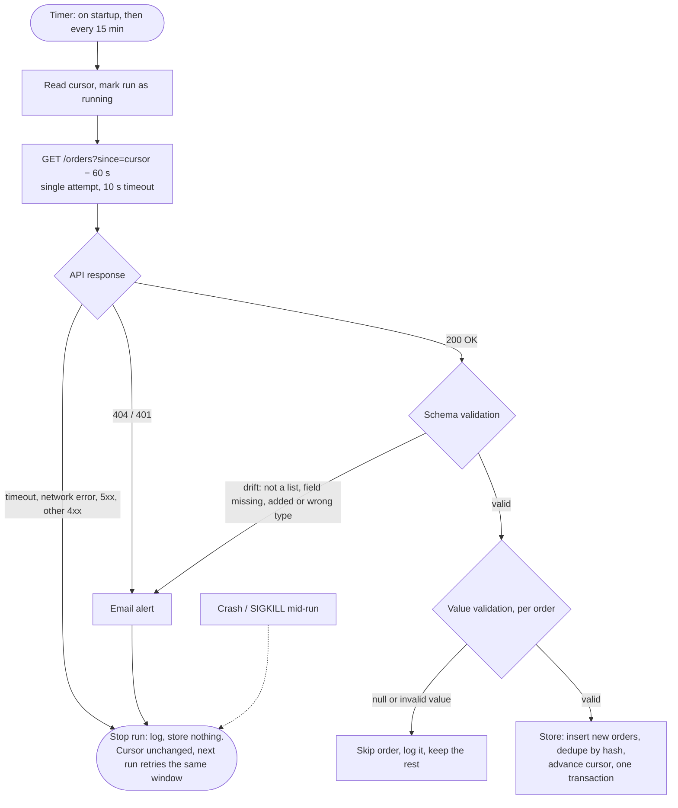

# Order Ingestion Worker

.NET 10 worker that pulls new orders from an HTTP API on startup and every 15 minutes, validates them against a strict schema, and stores each order exactly once in SQLite. Problems that need a person are emailed.

## How it works



## Task requirements

| #     | Requirement                     | Implementation                                                                                        |
| ----- | ------------------------------- | ----------------------------------------------------------------------------------------------------- |
| 1     | Fetch on startup + every 15 min | `BackgroundService` + `PeriodicTimer`; cycles never overlap                                           |
| 2     | Local database                  | SQLite, plain SQL via Dapper ORM                                                                      |
| 3     | No duplicates                   | `canonical_hash` = SHA-256(order id + customer id), unique index, `ON CONFLICT DO NOTHING`            |
| 4     | Log every run                   | Serilog: start + result line per cycle (with duration), `RunId` scope; console + JSON file            |
| 5     | Retry                           | The next cycle re-fetches from the unchanged cursor; writes are idempotent. No retries within a cycle |
| 6     | Monitoring                      | Per-cycle log, email alerts, Application Insights when configured                                     |
| Bonus | Application Insights            | OpenTelemetry log exporter, on when `APPLICATIONINSIGHTS_CONNECTION_STRING` is set                    |
| Bonus | CI/CD                           | GitHub Actions: tests on every push, deploy on merge to `main` (SSH step mocked)                      |
| Bonus | File import                     | Not done                                                                                              |

## Errors

| Case                                                                              | Outcome                                        | Email   |
| --------------------------------------------------------------------------------- | ---------------------------------------------- | ------- |
| 404 / 401                                                                         | Cycle ends                                     | **yes** |
| Schema drift: not JSON or not a list; a field missing, added or of the wrong type | Cycle ends, nothing stored                     | **yes** |
| Invalid value: null, unknown status, quantity ≤ 0, negative amount, empty `lines` | That order skipped and logged; the rest stored | —       |
| Timeout (10 s), network error, 5xx, other 4xx, unexpected exception               | Cycle ends; the next cycle retries             | —       |
| Duplicate order                                                                   | Skipped, counted                               | —       |

Identical emails at most once per hour. Invalid configuration fails at startup.

## Projects

| Project                                     | Contents                                                                          | References             |
| ------------------------------------------- | --------------------------------------------------------------------------------- | ---------------------- |
| `src/OrderIngestion.Domain`                 | Order model, dedupe hash, cursor, cycle logic, alert rules. No packages, no I/O   | —                      |
| `src/OrderIngestion.Infrastructure`         | Order API client + schema check, SQLite store (Dapper), SMTP (MailKit)            | Domain                 |
| `src/OrderIngestion.Worker`                 | Generic host, timer loop, Serilog, email dispatch. No web server                  | Domain, Infrastructure |
| `simulate/OrderIngestion.MockApi`           | Test-only upstream with switchable failures                                       | —                      |
| `tests/OrderIngestion.Domain.Tests`         | xUnit unit tests: cycle logic, cursor, dedupe hash, alert rules. Fakes, no I/O    | Domain                 |
| `tests/OrderIngestion.Infrastructure.Tests` | xUnit: schema check, HTTP failures (stubbed handler), SQLite store, mock contract | Infrastructure         |

## Storage

SQLite, schema in [`SqliteSchema.cs`](src/OrderIngestion.Infrastructure/Persistence/SqliteSchema.cs). Timestamps are ISO-8601 UTC.

### `sync`: one row per stored order

| Column           | Type      | Description                                                                      |
| ---------------- | --------- | -------------------------------------------------------------------------------- |
| `id`             | INTEGER   | Primary key                                                                      |
| `canonical_hash` | CHAR(64)  | SHA-256 of order id + customer id; unique index (the only index), the dedupe key |
| `timestamp`      | TIMESTAMP | Batch: start of the cycle that stored the row                                    |
| `payload`        | JSON      | The order exactly as received; nullable, can be dropped for GDPR                 |

### `cursor`: where ingestion stands, one row

| Column            | Type      | Description                                               |
| ----------------- | --------- | --------------------------------------------------------- |
| `id`              | INTEGER   | Always 1 (`CHECK`), so the table holds one row            |
| `last_run`        | TIMESTAMP | Start of the latest cycle                                 |
| `last_run_status` | TEXT      | `running` / `succeeded` / `failed`                        |
| `youngest_record` | TIMESTAMP | `createdAt` of the newest stored order: the read position |

- Each fetch asks for `since = max(youngest_record, 2026-01-01) − 60 s`. The overlap catches orders the API shows late; re-reads are dropped by the hash.
- `youngest_record` moves only in the same transaction as the orders, so a failure or crash never skips or half-saves anything.
- A leftover `running` means the previous cycle died (cycles never overlap); the next one logs it as "did not finish normally".

## Run

```bash
cp .env.example .env
docker compose -f compose.yml -f compose.cicd.yml up --build   # worker + mock API (:8080) + Mailpit inbox (:8025)
bash scripts/smoke-test.sh                                     # end-to-end checks, as in CI
dotnet test
```

| File               | Services                      | Used by                                    |
| ------------------ | ----------------------------- | ------------------------------------------ |
| `compose.yml`      | Worker                        | Server (alone), local runs, CI             |
| `compose.cicd.yml` | Mock order API, Mailpit inbox | Local runs and CI, on top of `compose.yml` |

Settings default in `appsettings.json` and are overridden via `.env` (`Section__Key`). Failures can be switched on at runtime: `PUT :8080/_mock/settings` with e.g. `{"scenario":"orders-drift"}` or `{"failureRate":1,"failureStatusCode":404}`.

## Tests and CI/CD

| What                                         | When                                                  | Covers                                                                                                                            |
| -------------------------------------------- | ----------------------------------------------------- | --------------------------------------------------------------------------------------------------------------------------------- |
| `dotnet test` (80)                           | Every push ([`test.yml`](.github/workflows/test.yml)) | Hash, schema check, HTTP failure handling, cursor and crash recovery, alert rules, SQLite incl. rollback                          |
| [`smoke-test.sh`](scripts/smoke-test.sh)     | Every push, after the unit tests                      | Whole stack: no duplicates after restart, SIGKILL mid-cycle, drift, invalid values, 503, 404, 401, emails                         |
| [`deploy.yml`](.github/workflows/deploy.yml) | PR merged into `main`                                 | Tests on the merge commit → SSH: server checks out that commit, `docker compose up --build` (mocked; real with `DEPLOY_MODE=ssh`) |

## Design decisions

| Decision                                        | Rationale                                                            |
| ----------------------------------------------- | -------------------------------------------------------------------- |
| Long-running worker, not cron                   | In-process timer; no overlap; a long cycle delays the next one       |
| No retries within a cycle                       | The next cycle is the retry; idempotent writes                       |
| `JsonSerializerOptions.Strict` + camelCase      | Defaults silently accept missing and unknown fields                  |
| Nulls pre-scanned in raw JSON                   | `OrderDto` stays non-nullable; a null skips one order, not the batch |
| Domain without I/O                              | Ports + `TimeProvider`; unit-tested with fakes                       |
| Mock API and Mailpit only in `compose.cicd.yml` | A server runs `compose.yml` alone, so test services never deploy     |
| Server builds the image from the tested commit  | No registry, no deploy-only compose file; trade-off below            |

## Known limits

- Dedupe is identity only: status changes or updates on stored orders are not picked up.
- An added API field pauses ingestion until `OrderDto` is updated (deliberate).
- A skipped nullish order is not re-fetched once the cursor passes it (it is logged).
- Deploy rebuilds the image on the server from the tested commit; the image CI tested is not the exact one that runs.
